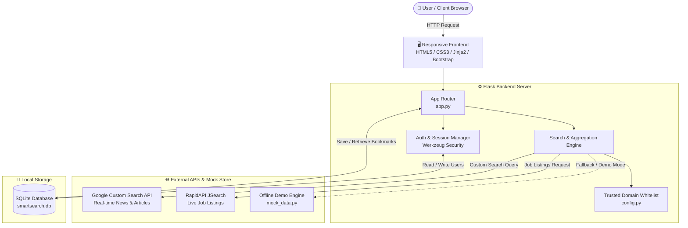
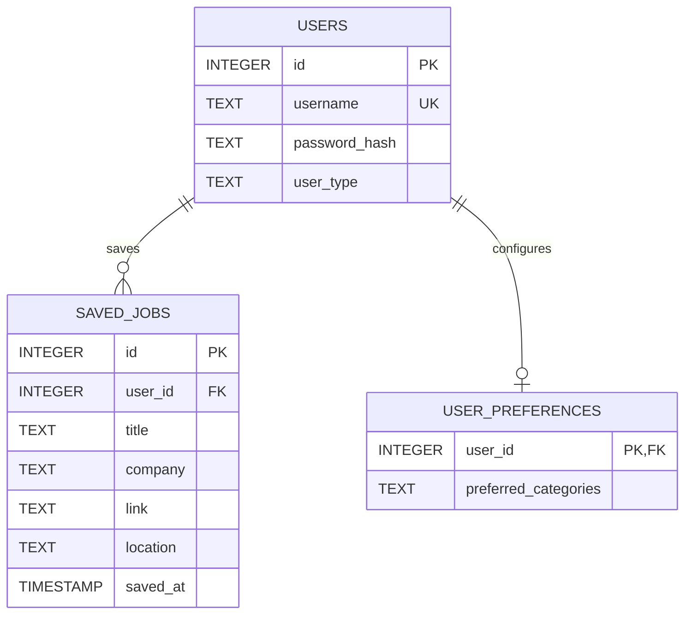

<div align="center">

# 🌐 NewsSphere
### *Intelligent, Persona-Driven News Aggregation & Real-Time Search*

[](https://www.python.org/)
[](https://flask.palletsprojects.com/)
[](https://www.sqlite.org/)
[](https://getbootstrap.com/)
[](LICENSE)

<p align="center">
  <b>Tired of clickbait, SEO farms, and cluttered feeds?</b><br>
  NewsSphere delivers a focused, verified, and distraction-free news reading experience tailored directly to your persona and domain.
</p>

[Explore Features](#-key-features) •
[Architecture](#-system-architecture) •
[Quick Start](#-setup--installation) •
[API Guide](#-api-keys--configuration) •
[Project Structure](#-project-directory-structure) •
[Team](#-team-roles--contributions)

---

</div>

## 📌 Problem & Motivation

Modern news consumption suffers from three major challenges:
1. **Information Overload:** Readers are inundated with hundreds of repetitive, low-value articles across miscellaneous categories.
2. **SEO Link Farms & Clickbait:** Search engines frequently rank advertising-heavy content mills above verified journalism.
3. **Context Mismatch:** A computer science student, a stock market trader, and a farmer require completely different information feeds and trusted authorities.

**NewsSphere** solves this by combining **persona-based domain whitelisting**, **real-time REST API integration**, and an **elegant, distraction-free reading UI**.

---

## ✨ Key Features

| Feature | Description |
| :--- | :--- |
| 🎯 **Persona-Tailored Feeds** | Pre-configured feeds specifically curated for **Students**, **Job Seekers**, **Farmers**, **Sports Fans**, **Engineers**, **Investors**, and **Researchers**. |
| 🛡️ **Anti-Spam Whitelist Engine** | Every query dynamically searches across pre-vetted, high-reputation domains (e.g., IEEE, BBC, Reuters, arXiv, Nature, LeetCode, Agmarknet) to eliminate SEO spam. |
| 🔍 **Live Real-Time Search** | Global search bar supporting any query, trending hashtags (`#AI`, `#StockMarket`, `#Gaganyaan`, `#Cricket`), and category pills. |
| 💼 **Integrated Job Search** | Real-time career listing retrieval powered by RapidAPI JSearch with employer details, application links, and locations. |
| 📖 **Quick Reader Modal** | Read full article previews and summaries inside a clean in-app modal without navigating away or getting bombarded with popups. |
| 🔖 **Bookmark & Likes** | Authenticated users can like stories and save articles/job listings directly to their personal dashboard for future reading. |
| 🌓 **Adaptive Dark/Light Theme** | Built-in theme switcher with anti-flash script ensuring instantaneous, flicker-free rendering according to user preference. |
| 🧪 **Offline Presentation Demo Mode** | Comprehensive fallback dataset (`mock_data.py`) containing 1,400+ lines of real-world articles for reliable offline demos and testing. |

---

## 🏗️ System Architecture



---

## 🗂️ Supported Personas & Domain Whitelist

NewsSphere limits search queries to verified domain clusters per user type:

| User Persona | Focus Categories | Curated Domains |
| :--- | :--- | :--- |
| 🎓 **Student** | Coding, Tutorials, Research, Internships | `geeksforgeeks.org`, `w3schools.com`, `nptel.ac.in`, `leetcode.com`, `arxiv.org`, `internshala.com` |
| 💼 **Job Seeker** | Jobs, Interviews, Career Tips | `linkedin.com`, `naukri.com`, `indeed.com`, `glassdoor.com`, `interviewbit.com` |
| 🚜 **Farmer** | Crop Prices, Weather, Agriculture News | `agmarknet.gov.in`, `pmkisan.gov.in`, `krishijagran.com` |
| 📈 **Stock Investor**| Market Trends, Sensex, Financial Analysis | `moneycontrol.com`, `economictimes.indiatimes.com`, `nseindia.com` |
| 🔬 **Researcher** | Academic Papers, Breakthroughs | `scholar.google.com`, `researchgate.net`, `arxiv.org` |
| ⚽ **Sports Fan** | Live Scores, Global Tournaments, Cricket | `espn.com`, `skysports.com`, `espncricinfo.com` |
| 💻 **Engineering** | Journal Publications, Tech Innovations | `ieee.org`, `arxiv.org`, `techcrunch.com` |
| 📰 **General News** | Verified Global & National Headlines | `bbc.com`, `reuters.com`, `thehindu.com`, `ndtv.com` |

---

## 🛠️ Technology Stack

- **Backend:** Python 3.8+, Flask 2.x, Werkzeug (Password Security & Hash Generation)
- **Database:** SQLite 3 (Lightweight, zero-configuration relational database)
- **Frontend:** HTML5, CSS3, JavaScript (ES6+), Jinja2 Templates, Font Awesome 6.5
- **Design System:** Responsive CSS Grid & Flexbox, Glassmorphism, CSS Custom Properties (Theme Variables)
- **External APIs:**
  - [Google Custom Search JSON API](https://developers.google.com/custom-search/v1/overview)
  - [JSearch via RapidAPI](https://rapidapi.com/letscrape-6bRBa3QguO5/api/jsearch)
  - [Google Favicons Service](https://www.google.com/s2/favicons)

---

## 📁 Project Directory Structure

```text
SmartSearch/
├── app.py                  # Core Flask server, routing, and search integration
├── config.py               # Active configuration & API credential mappings
├── config_template.py      # Template configuration file for initial setup
├── models.py               # SQLite schema definition (Users, Saved Jobs, Preferences)
├── mock_data.py            # Comprehensive offline demo dataset (1,400+ lines)
├── requirements.txt        # Python package dependencies
├── smartsearch.db          # Local SQLite relational database file
├── static/
│   └── css/
│       └── style.css       # Unified design system, dark/light themes, animations
├── templates/
│   ├── landing.html        # Interactive newsfeed, trending bar, reader modal
│   ├── login.html          # Space-themed animated login & registration UI
│   └── saved.html          # Dashboard for bookmarks & saved articles
└── scratch/                # Utility scripts & automated feature tests
```

---

## 🚀 Setup & Installation

Follow these instructions to set up NewsSphere locally:

### 1. Clone the Repository
```bash
git clone https://github.com/yourusername/SmartSearch.git
cd SmartSearch
```

### 2. Create and Activate a Virtual Environment
```bash
# On Windows:
python -m venv venv
venv\Scripts\activate

# On macOS/Linux:
python3 -m venv venv
source venv/bin/activate
```

### 3. Install Dependencies
```bash
pip install -r requirements.txt
```

### 4. Configure API Keys
Copy the provided configuration template to `config.py`:
```bash
# On Windows:
copy config_template.py config.py

# On macOS/Linux:
cp config_template.py config.py
```
Open `config.py` in your editor and enter your credentials (see [API Guide](#-api-keys--configuration)).

### 5. Initialize the Database
Run the schema initialization script to create all required tables:
```bash
python -c "from models import init_db; init_db()"
```

### 6. Run the Application
```bash
python app.py
```
Open your browser and navigate to:
```text
http://127.0.0.1:5000
```

---

## 🔑 API Keys & Configuration

To enable live searching, provide the following parameters inside `config.py`:

| Variable | Provider | Purpose | Where to Obtain |
| :--- | :--- | :--- | :--- |
| `GOOGLE_API_KEY` | Google Cloud Console | Authorizes Custom Search API queries | [Google Cloud Console](https://console.cloud.google.com/) |
| `GOOGLE_CX` / `GOOGLE_CX_ID` | Google PSE | Custom Search Engine identifier | [Programmable Search Engine](https://programmablesearchengine.google.com/) |
| `RAPIDAPI_KEY` | RapidAPI | Authorizes job search requests | [RapidAPI JSearch](https://rapidapi.com/letscrape-6bRBa3QguO5/api/jsearch) |
| `RAPIDAPI_HOST` | RapidAPI | JSearch host endpoint (`jsearch.p.rapidapi.com`) | RapidAPI JSearch Documentation |
| `SECRET_KEY` | Local | Signs Flask session cookies securely | Generated random key or environment variable |

> [!TIP]
> **No API keys handy?**
> You can generate a random secret key quickly in your terminal:
> ```bash
> python -c "import secrets; print(secrets.token_hex(32))"
> ```
> NewsSphere is equipped with `mock_data.py`, allowing you to inspect and demo the entire UI and features even before configuring external API keys.

---

## 🗄️ Database Schema

The SQLite database (`smartsearch.db`) consists of three relational tables:



---

## 👥 Team Roles & Contributions

This project was built collaboratively by a dedicated 4-person team:

| Role | Member | Responsibilities |
| :--- | :--- | :--- |
| 🎨 **Frontend Engineer** | **Member 1** | Designed responsive layout, card grids, Dark/Light theme switcher, and modal views using CSS3 & Bootstrap. |
| ⚙️ **Backend Engineer** | **Member 2** | Built Flask routing, session management, user authentication, and SQLite database persistence. |
| 🔌 **API & Data Specialist** | **Member 3** | Implemented Google Custom Search & RapidAPI JSearch pipelines, domain whitelisting, and query sanitization. |
| 📋 **Project Lead & QA** | **Member 4** | Orchestrated Git workflow, documentation, automated test suites (`scratch/test_like_save.py`), and bug fixes. |

---

## 🔮 Future Roadmap

- [ ] **🤖 AI Summarization:** Integrate Google Gemini or OpenAI API to deliver one-click, 3-bullet-point article recaps.
- [ ] **🔍 Fact-Checking & Credibility Score:** Algorithmic trust scoring for breaking news stories based on multi-outlet corroboration.
- [ ] **🌐 Multi-Language Support:** Instant translation for regional languages (e.g., Hindi, Spanish, French).
- [ ] **🔔 Real-time Notifications:** Web push notifications for breaking alerts matching custom user keywords.
- [ ] **📱 Mobile Client:** Native Android & iOS application powered by React Native or Flutter.

---

## 📄 License

This project is licensed under the [MIT License](LICENSE) — feel free to use, modify, and distribute this codebase for educational and personal projects.

<div align="center">
  <sub>Built with ❤️ for a cleaner, smarter, and distraction-free web.</sub>
</div>
